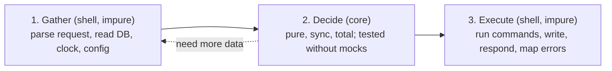

# TypeScript Constitution (Proof by Type)

v1, 2026-10-14. Forked from the Claude doc draft; this file is now the canonical version.

Naming, ordering, comments and test placement follow the global wiki (`bun_typescript.md`, `code_style.md`): `snake_case` files and values, PascalCase types, alpha-ordered keys after the discriminant.

## Preamble: TypeScript is not Lean, so we shrink and audit its holes

TypeScript's checker is unsound by design. Lean's kernel proves; TypeScript's checker only constrains. This constitution makes the unsound surface small, explicit and counted, so the rest of the code can be trusted the way a proof is.

A type is a claim about data ("this was parsed", "this state is complete", "every case is handled"). The only proof of the claim is the single function allowed to build that type.

| Lean concept | TypeScript equivalent | Strength |
| --- | --- | --- |
| Proposition as type | Branded or discriminated type | Medium: nominal only by convention |
| Proof term | Smart constructor or parser returning a result | Strong if it is the only constructor |
| Totality | Exhaustive switch reaching `never` | Strong, with lint |
| `sorry` and axioms | `as`, `any`, `!`, `@ts-expect-error`, third-party `.d.ts` | Ledgered (Article VI) |
| Small trusted kernel | Compiler plus a few boundary parsers | Strong if parsers are few |
| Effect tracking | None built in; folder tsconfig and lint | Weak unless enforced (Article II) |
| Dependent types | Generics, template literal types | Weak; avoid type-level gymnastics |

Purity is not checkable by the type system: a function typed `(a: A) => B` can call `fetch`. Purity is enforced by folder boundaries and compiler configuration. Rigor comes from small trusted kernels, not clever types.

### Proofs have a location

Every guarantee is enforced somewhere. A compiler check leaves a type behind; a CI or review check leaves nothing at runtime. This table is the record of where each one lives.

| Guarantee | Enforced by |
| --- | --- |
| Strict checker flags (Article I) | Compiler |
| Core cannot call I/O globals (Article II) | Compiler (core tsconfig) and oxlint |
| Core never imports the shell (Article II) | oxlint `no-restricted-imports` in CI |
| `Intl` in the core gets explicit locale and time zone (Article II) | Review |
| Exhaustive handling of unions (Article IV) | Compiler and oxlint |
| Inputs become domain types (Articles III, V) | Runtime parser at the boundary |
| Configuration is valid (Article V) | Startup parser |
| Scoped reads require a principal (Article V) | Compiler (provenance brand); Postgres RLS underneath |
| Every `as` is visible (Article VI) | oxlint `consistent-type-assertions` |
| Escape-hatch count never grows silently (Article VI) | CI count |
| Behavioral properties (Article VII) | CI tests |

## Article I — Axioms: the checker runs at maximum strictness

Every package extends shared bases from [@tsconfig/bases](https://github.com/tsconfig/bases). A flag is relaxed only with a written reason in the repo.

```json
{
  "extends": [
    "@tsconfig/node-lts/tsconfig.json",
    "@tsconfig/node-ts/tsconfig.json",
    "@tsconfig/strictest/tsconfig.json"
  ]
}
```

Later entries override earlier ones, so `strictest` goes last: no runtime base can loosen a strictness flag (`@tsconfig/bun` sets `noUnusedLocals: false`; `strictest` turns it back on).

| Package | Extends, in this order |
| --- | --- |
| Shell on Bun | `bun`, `strictest`; set `erasableSyntaxOnly` |
| Shell on Node (server, worker, CLI) | `node-lts` (or a pinned `node24`), `node-ts`, `strictest` |
| Frontend (React with Vite) | `vite-react`, `strictest`; set `verbatimModuleSyntax`, `erasableSyntaxOnly` if missing |
| Core | `strictest` only, plus the overrides in Article II |

What the bases cover:

- `strictest`: `strict`, `noUncheckedIndexedAccess`, `exactOptionalPropertyTypes`, `noImplicitOverride`, `noImplicitReturns`, `noFallthroughCasesInSwitch`, `noPropertyAccessFromIndexSignature`, `allowUnreachableCode: false`, `allowUnusedLabels: false`, `noUnusedLocals`, `noUnusedParameters`, `isolatedModules`, `esModuleInterop`, `skipLibCheck`.
- `node-ts`: `verbatimModuleSyntax`, `erasableSyntaxOnly`, `rewriteRelativeImportExtensions`.
- `node-lts`: Node 24, ES2024, `module: nodenext`, `types: ["node"]`.

`skipLibCheck: true` leaves third-party `.d.ts` unchecked, consistent with treating them as axioms (Article VI).

Pin exact versions of the @tsconfig packages: they follow runtime versions, not semver. CI commits a `tsc --showConfig` snapshot per package and fails when it changes, so a base upgrade cannot loosen a flag silently.

Why the non-obvious ones matter:

- `noUncheckedIndexedAccess`: `arr[0]` and `record[key]` become `T | undefined`. Closes the most common silent hole.
- `exactOptionalPropertyTypes`: "absent" and "present but undefined" become different states, as they are at runtime.
- `erasableSyntaxOnly`: bans enums, namespaces and parameter properties. Code is plain JavaScript plus erasable types, which runs under Node and Bun type stripping.

### Lint: oxlint with type-aware rules

Lint is the second half of the axioms. oxlint runs with `oxlint-tsgolint` installed and `typeAware` on; tsgolint is stable (2026-07-22) and covers every typed rule below. oxlint has no `strictTypeChecked` preset, so rules are listed by name:

```json
{
  "options": { "typeAware": true },
  "rules": {
    "typescript/ban-ts-comment": ["error", { "ts-expect-error": "allow-with-description", "ts-ignore": true }],
    "typescript/consistent-type-assertions": ["error", { "assertionStyle": "never" }],
    "typescript/no-explicit-any": "error",
    "typescript/no-floating-promises": "error",
    "typescript/no-misused-promises": "error",
    "typescript/no-non-null-assertion": "error",
    "typescript/no-unnecessary-condition": "error",
    "typescript/no-unsafe-argument": "error",
    "typescript/no-unsafe-assignment": "error",
    "typescript/no-unsafe-call": "error",
    "typescript/no-unsafe-member-access": "error",
    "typescript/no-unsafe-return": "error",
    "typescript/only-throw-error": "error",
    "typescript/strict-boolean-expressions": "error",
    "typescript/switch-exhaustiveness-check": "error"
  },
  "overrides": [
    {
      "files": ["src/core/**"],
      "rules": {
        "no-restricted-globals": ["error", "Date"],
        "no-restricted-imports": ["error", { "patterns": ["\\#shell/**", "**/shell/**"] }],
        "no-restricted-properties": ["error", { "object": "Math", "property": "random" }]
      }
    },
    {
      "files": ["**/*.test.ts"],
      "rules": { "typescript/consistent-type-assertions": "off" }
    }
  ]
}
```

oxlint gotchas: `no-restricted-imports` matches the specifier as written, so ban both the `#` alias (escaped, gitignore syntax) and the relative path. A later `overrides` entry replaces a rule for the files it matches, so a stricter folder repeats the base patterns.

## Article II — Architecture: decisions are pure, effects live at the edge

The core receives values and returns decisions as data. The shell gathers inputs, calls the core once, and executes the decision. This is dependency rejection: the core never needs injected dependencies, mocked or otherwise.



### The 3-phase sandwich

```ts
// src/core/membership/decide_join.ts: pure, synchronous, total
export type JoinInput = {
  readonly invite: Invite | null;
  readonly now: Instant; // time is an input, never read
  readonly org: Org;
  readonly user: User;
};

export type JoinDecision =
  | { readonly kind: "join"; readonly events: readonly DomainEvent[]; readonly membership: NewMembership }
  | { readonly kind: "reject"; readonly reason: "already-member" | "invite-expired" | "org-full" };

export const decide_join = (input: JoinInput): JoinDecision => { /* ... */ };

// src/shell/http/join_handler.ts: impure, thin, no domain branching
export const join_handler = (deps: Deps) => async (req: Request) => {
  const input = await gather_join_input({ deps, req }); // 1. read
  const decision = decide_join(input);                  // 2. decide
  return execute_join({ decision, deps });              // 3. write and respond
};
```

### Rules of the core

1. No `async`, no I/O, no `throw` for domain outcomes.
2. No ambient reads: time, randomness, IDs, config, locale and time zone arrive as arguments.
3. Returns data describing what should happen: a discriminated union of outcomes or commands.
4. Imports only other core modules and pure libraries (zod, ts-pattern).
5. No classes: plain data and functions.
6. A test of the core needs no mock. Needing one is a violation signal.

### Making the compiler enforce purity

The core is a folder, `src/core/`, with its own `src/core/tsconfig.json`. Editors pick the nearest tsconfig, so the restriction shows while typing; no monorepo needed.

```json
{
  "extends": ["@tsconfig/strictest/tsconfig.json"],
  "compilerOptions": {
    "allowImportingTsExtensions": true,
    "erasableSyntaxOnly": true,
    "lib": ["ES2023"],
    "module": "nodenext",
    "noEmit": true,
    "target": "ES2023",
    "types": [],
    "verbatimModuleSyntax": true
  }
}
```

The core never extends a runtime base: `node-lts` sets `types: ["node"]`, which brings `process` and `setTimeout` back. `allowImportingTsExtensions` is required: without it `import "./x.ts"` fails with TS5097 under `nodenext`. Set `module` to match the shells that import the core.

Without the DOM lib and `@types/node`, `fetch`, `process`, `console`, `setTimeout` and `localStorage` do not exist there; calling them is a compile error. The ES lib still exposes `Date`, `Math.random` and `Intl`: the Article I overrides ban the `Date` global and `Math.random`. `Intl` stays allowed because user-facing formatting goes through it, but its defaults read the host locale and time zone, so core code always passes `locale` and `timeZone` explicitly (review-enforced).

### When the sandwich does not fit

When the decision needs data that depends on an earlier decision, prefer, in order:

1. Gather a superset eagerly, if it is cheap.
2. Stack sandwiches: the core returns `{ kind: "need", query }`, the shell fetches, calls the core again. The loop lives in the shell; every step stays pure.
3. Return a program of commands and interpret it in the shell. Only for real workflows, such as sagas or multi-step jobs.

A transaction that reads with `SELECT ... FOR UPDATE`, decides, then writes is still a sandwich; the whole sandwich runs inside the transaction. Transaction boundaries belong to the shell.

### One decision, many consumers

Reports, statistics, dashboards and access gates call the same core decision function. A second implementation, even a "read-only" one, drifts from the first.

When performance demands a second implementation, such as a SQL aggregation, the core function becomes its oracle: a property test runs both on generated data and asserts they agree (Article VII).

## Article III — Types as propositions: illegal states do not compile

A domain type is a claim; its constructor is the proof. Everything that enters from outside is `unknown` until a parser turns it into a domain type, and nothing downstream checks it again.

### 1. Parse, don't validate

A validator answers yes or no and throws the knowledge away. A parser returns a stronger type that carries the knowledge forward.

```ts
const Email = z.email().brand<"Email">();
type Email = z.infer<typeof Email>;

// boundary: unknown -> Email, exactly once
const parsed = Email.safeParse(body.email);
// core: functions take Email, never string
const send_welcome = (to: Email): Command => ({ kind: "send-email", to });
```

zod 4 is the parser library, imported as `import * as z from "zod"`. A frontend package that counts bytes may use valibot instead (`zod/mini` measured ~30 KB on a 76 KB bundle). Choose one per package, never per file.

Conventions:

- One schema per domain type, next to it and sharing its name: the value is the parser, the type is its output.
- Identifiers normalize inside the schema with `.trim()`, `.toLowerCase()` or `.transform()`, validate with `.pipe()`, then brand (rule 5).
- Boundaries call `safeParse` and turn the outcome into a `Result` (Article IV). Throwing `parse` only at startup, where a crash is the intended outcome.
- `ZodError` never crosses into the core: the boundary maps it to the domain error union.
- `z.any()` is `any`, so it is banned. `.catch()`, and `.default()` on malformed input, are hatches (Article VI).
- When a transform makes input and output differ, `z.input<typeof S>` types the wire format and `z.infer<typeof S>` the domain value.

```ts
export const Siren = z
  .string()
  .transform((s) => s.replace(/\s/g, ""))
  .pipe(z.string().regex(/^\d{9}$/))
  .brand<"Siren">();
export type Siren = z.infer<typeof Siren>;
```

### 2. Brands give nominal identity: shape or provenance

`UserId` and `OrgId` are both strings, so structural typing lets you swap them. A brand stops that. Two kinds, chosen by what the type claims:

- **Shape brand** (`Email`, `Siren`, `UserId`): the claim is about the bytes, so a parser can prove it. Built with zod `.brand<"X">()`, no hand-written `as`.
- **Provenance brand** (`Principal`, a verified webhook): the claim is about where the value came from, which no parser can check. Built with a module-private `unique symbol` and one ledgered `as` in the module that establishes the provenance (Article V).

A zod brand is forgeable without a cast: any module can declare `z.object({...}).brand<"Principal">()` and its `.parse` output type-checks as the real one. A `unique symbol` brand cannot be built outside its module without an `as`, which the lint flags and the ledger counts. Use a zod brand only for shape claims.

### 3. Unions over flags

```ts
// Bad: 4 representable states, 2 legal
type Payment = { status: "paid" | "pending"; paid_at?: Instant };

// Good: only legal states exist
type Payment =
  | { readonly status: "paid"; readonly paid_at: Instant }
  | { readonly status: "pending" };
```

Count representable states versus legal states. Any gap is a bug waiting for a caller.

No sentinel values inside a branded field. "Unknown" is its own variant, `{ kind: "unknown" }`, never a made-up string such as `ref:<id>` that passes for a real identifier. If a sentinel reached a branded field, either the parser accepted it or someone wrote `as`. Fix it there.

### 4. A decision keeps its reason

If a caller must query the data again to learn why a function returned `null`, the return type is too lossy. Return a union whose variants carry their evidence.

Encode counts in the type only when the decision branches on them: non-empty is `readonly [T, ...T[]]`, at least two is `readonly [T, T, ...T[]]`. These shapes do not survive `.filter` or `.map`, so each use needs a re-check. Elsewhere, a smart constructor enforces the count.

```ts
// Before: null hides two different outcomes
const find_owner = (records: readonly PartnerRecord[]): Siren | null => {
  const sirens = new Set(records.map((r) => r.siren));
  if (sirens.size !== 1) return null; // undeclared or shared? the caller cannot tell
  return [...sirens][0] ?? null;
};

// After: each outcome carries its evidence
type Ownership =
  | { readonly kind: "owned"; readonly siren: Siren }
  | { readonly kind: "shared"; readonly sirens: readonly [Siren, Siren, ...Siren[]] }
  | { readonly kind: "undeclared" };

const decide_ownership = (records: readonly PartnerRecord[]): Ownership => {
  const sirens = [...new Set(records.map((r) => r.siren))].sort();
  const [first, second, ...rest] = sirens;
  if (first === undefined) return { kind: "undeclared" };
  if (second === undefined) return { kind: "owned", siren: first };
  return { kind: "shared", sirens: [first, second, ...rest] };
};
```

The tuple is built without a cast, because `noUncheckedIndexedAccess` forces the `undefined` checks that prove the count. The sort makes the result independent of input order. The `Set` deduplicates correctly only because `Siren` is canonical (rule 5).

### 5. Identifiers are canonical brands

Any value used as a map key, in an equality check or as an identity (domain, email, SIREN) has exactly one parser, and that parser normalizes it: trim, lowercase where the domain allows, drop a trailing dot from domain names. Equality on an unnormalized string is a hidden bug.

Normalization is domain logic and can be wrong. Domain names need IDNA handling, not just lowercasing; an email's local part is technically case-sensitive. Decide each rule once, in the parser. When the original form matters for display or audit, store `{ canonical, raw }` and compare only on `canonical`.

### 6. Smaller rules

- `readonly` everywhere in the core; `ReadonlyArray`, `ReadonlyMap`.
- String literal unions or `as const` objects instead of enums.
- `satisfies` instead of annotations for config objects, so literal types survive.
- Prefer one boring correct type over a clever conditional type. A type that needs a comment to be read is too clever.

## Article IV — Errors as values; every case is handled

An expected failure is part of the return type. An exception means a bug or an infrastructure fault, never a domain outcome. A `throw` is invisible to the checker: callers cannot see it, and `catch (e)` gives `unknown`.

The error model is plain discriminated unions plus this `Result`; no neverthrow, no Effect.

```ts
type Result<T, E> =
  | { readonly ok: true; readonly value: T }
  | { readonly error: E; readonly ok: false };

const ok = <T>(value: T): Result<T, never> => ({ ok: true, value });
const err = <E>(error: E): Result<never, E> => ({ error, ok: false });
```

In the core, a domain-specific union often beats a generic `Result`: `JoinDecision` already says everything. Use `Result` for parsers and small helpers.

### Exhaustiveness is your totality checker

```ts
const assert_never = (x: never): never => {
  throw new Error(`Unhandled case: ${JSON.stringify(x)}`);
};

switch (decision.kind) {
  case "join": return execute_join(decision);
  case "reject": return reject_response(decision.reason);
  default: return assert_never(decision);
}
```

Add a variant to the union and every unhandled `switch` fails to compile. ts-pattern's `.exhaustive()` gives the same guarantee. A `default` that returns a fallback value destroys it, so a `default` on a union always reaches `assert_never`.

### Errors cross the boundary through one total function

Each runtime owns one mapping from domain errors to its protocol: HTTP status, CLI exit code, UI state, or ack/nack. That mapping is itself an exhaustive switch, so a new error kind cannot reach a user unmapped.

## Article V — One core, a different thin shell per runtime

The core is the same folder everywhere. Only the shell changes: where input is parsed, which effects run, and how errors are mapped.

| Runtime | Parse at the boundary | Effects the shell runs | Error mapping |
| --- | --- | --- | --- |
| HTTP server | Body, query, params, headers; JSONB and raw SQL rows | DB transaction, outbound calls, response | Domain error to status code and body |
| CLI | argv, env, stdin, file contents | File writes, stdout, network | Domain error to exit code and stderr |
| Frontend (React) | Server responses, URL params, form input, browser storage | Fetch, navigation, storage writes | Domain error to a UI state variant |
| Message worker (RabbitMQ) | Message payload and headers | Ack, nack, publish, DB writes | Domain error to ack, retry, or dead-letter |

Rules for all four:

- Configuration is parsed once at startup into a frozen typed object. Invalid config stops the process before it serves anything.
- Database rows typed by Drizzle are trusted for columns Drizzle owns. JSONB columns and raw SQL results are `unknown` and get parsed.
- On the frontend, a reducer is the functional core: `(state, event) => state` is pure and testable. UI state is a union such as `idle | loading | loaded | failed`, never a set of booleans.
- In a worker, the core decides ack, retry or dead-letter as data. Handlers are idempotent, because redelivery is normal.
- Classes appear in a shell only when a library requires one (`extends Error`, a framework base class).

### Authorization is part of the port's type

Store interfaces never accept a `Record<string, unknown>` filter. A scoped read takes its scope as required fields, so an unscoped query does not compile.

A required `owner: string` only proves a value was passed, not that it came from the session. The scope is a `Principal` provenance brand that only the authentication middleware module can build:

```ts
// src/shell/http/auth.ts
declare const principal_brand: unique symbol;

export type Principal = {
  readonly [principal_brand]: true;
  readonly org_id: OrgId;
  readonly user_id: UserId;
};

export const principal_from_session = (session: VerifiedSession): Principal =>
  // oxlint-disable-next-line typescript/consistent-type-assertions -- provenance: built only from a verified session
  ({ org_id: session.org_id, user_id: session.user_id }) as Principal;

interface InvoiceStore {
  find_by_id(args: { readonly id: InvoiceId; readonly principal: Principal }): Promise<Invoice | undefined>;
  list_for_org(args: { readonly principal: Principal }): Promise<readonly Invoice[]>;
}
```

A plain object literal typed `Principal` fails with TS2741; forging one elsewhere needs an `as`, which the lint flags. Postgres RLS stays underneath as defense in depth: the type protects TypeScript code, not a raw SQL path.

## Article VI — Escape hatches: every `sorry` is ledgered and counted

In Lean, `#print axioms` lists every assumption a theorem rests on. TypeScript needs the same discipline by hand. An escape hatch is allowed only where it is visible, justified and counted.

| Hatch | Rule |
| --- | --- |
| `any` | Banned. Use `unknown` and parse. |
| `!` non-null assertion | Banned. Narrow, or return an error. |
| `as` assertion | Banned by `consistent-type-assertions: never` (`as const` passes). A necessary one carries `// oxlint-disable-next-line typescript/consistent-type-assertions -- <why it holds>` |
| `@ts-expect-error` | Only with a description; `@ts-ignore` is banned |
| Third-party `.d.ts` | Axiom: wrap the library in an adapter that parses what it returns |
| `JSON.parse`, `res.json()` | Return `any`; type the result as `unknown` immediately |
| `.catch()` on a schema | Hatch: it hides malformed input. A parser over a collection returns `{ rejected, value }` and the caller sets a threshold on `rejected` |
| `.default()` on a schema | Allowed for a field optional by design; a hatch when it replaces malformed input |
| Missing config replaced by an empty default | Banned: a missing config file or required variable is a startup error |
| Generic casts such as `collection<T>()` | Axiom: an `as` with extra steps. Parse what it returns |
| ORM types derived from the schema (Drizzle columns) | Trusted for columns the ORM owns (Article V); JSONB and raw SQL are parsed |
| Typed framework context (Hono `Variables`) | Derive the type from the middleware chain; never declare it by hand |

zod's `.brand()` is itself a type-level cast, accepted once as a library axiom for shape brands. The disable directive is the only comment a hatch gets; its `-- why` is mandatory by review.

The **ledger** is the count CI takes on every pull request: `oxlint-disable` directives plus `@ts-expect-error` comments, outside `*.test.ts`. The count only goes up with an explicit review note. This is your `#print axioms`: one number that says how much of the codebase rests on trust.

Tests may use `as` freely (the lint override in Article I) and are not counted, but fixtures still come from parsers or fast-check arbitraries, so a test never builds an illegal state.

## Article VII — What types cannot prove, properties test

Types prove shape. Behavior ("never grants a membership on an expired invite") needs a theorem; in TypeScript the nearest thing is a property-based test with fast-check. A pure core makes these cheap: nothing to mock.

Runner: `bun test` on Bun packages, vitest on Node and Vite packages. `*.test.ts` sits next to the source it covers.

```ts
import fc from "fast-check";

test("an expired invite never produces a membership", () => {
  fc.assert(
    fc.property(arb_join_input({ invite_expired: true }), (input) => {
      expect(decide_join(input).kind).toBe("reject");
    }),
  );
});
```

Families of properties:

- Round trip: `parse(serialize(x))` equals `x`.
- Idempotence: applying a decision twice equals applying it once. Critical for message workers.
- Invariants: a balance is never negative; a total equals the sum of its lines.
- Oracle: the optimized function agrees with a slow, obviously correct one.
- Order independence: shuffling the input never changes the decision. Catches any reliance on `records[0]`.
- Monotonicity: adding evidence never weakens a refusal; a new owner record never turns `shared` into `owned`. Each decision states whether it is monotone.

### Negative type tests prove impossibility

The most Lean-like test in TypeScript asserts that something does not compile:

```ts
// @ts-expect-error: a pending payment has no paid_at
const bad: Payment = { paid_at: now, status: "pending" };
```

If someone loosens the type, the expected error disappears and `tsc` fails, under any runner. vitest packages may add `expectTypeOf` for positive type assertions.

Test pyramid: many property and unit tests on the core, few integration tests on the shell against a real Postgres and RabbitMQ in containers, almost nothing in between.

## Learning path

Reading list and retrofit exercises for the human: [learning_path.md](learning_path.md).
